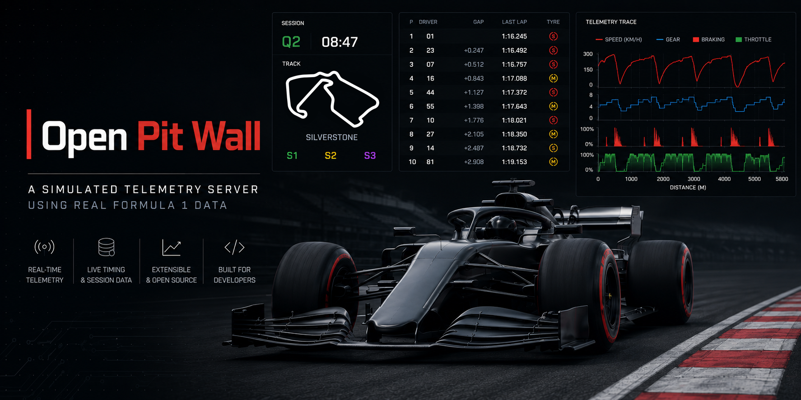

# APEX Pit Wall Telemetry Gateway 📡🏎️

<p align="center">
  
</p>

<p align="center">
  <b>High-throughput Formula 1 telemetry replay and streaming gateway engineered in Python, coupled with a Spacelith brutalist 3D chassis live dashboard.</b>
</p>

<p align="center">
  
  
  
  
</p>

---

## ⚡ Overview

**APEX Pit Wall Telemetry Gateway** ek asynchronous, low-latency motorsport data pipeline aur streaming architecture hai jise **Chirag Raj Dadhich** ne develop kiya hai. 

Yeh system FIA / FastF1 timing loops aur high-frequency car dynamics ko ingest karke frame-by-frame kinematics serialize karta hai, aur non-blocking local WebSocket server (`ws://127.0.0.1:8765`) par 20Hz deterministic packets broadcast karta hai. Saath hi isme ek standalone **Spacelith-style brutalist web dashboard** shamil hai jo browser ke andar live Three.js 3D chassis wireframe aur 60 FPS rolling canvas waveforms render karta hai.

---

## 🏛️ System Architecture

```text
                  ┌───────────────────────────────┐
                  │       FIA / FastF1 API        │
                  │   (Raw Timing & Telemetry)    │
                  └───────────────┬───────────────┘
                                  │
                                  ▼
                  ┌───────────────────────────────┐
                  │     APEX Ingestion Engine     │
                  │  (Multi-Thread Limited Cache) │
                  └───────────────┬───────────────┘
                                  │ JSON Cache
                                  ▼
                  ┌───────────────────────────────┐
                  │    WebSocket Broadcaster      │
                  │       (ws://127.0.0.1:8765)   │
                  └───┬───────────────────────┬───┘
                      │                       │
      pub/sub stream  │                       │  pub/sub stream
                      ▼                       ▼
       ┌────────────────────────┐   ┌────────────────────────┐
       │   Spacelith 3D Web UI  │   │ Terminal Trace Client  │
       │ (Three.js Wireframe,   │   │  (examples/driver-     │
       │  Rolling Canvas Waves) │   │   telemetry-trace)     │
       └────────────────────────┘   └────────────────────────┘

```

---

## ✨ Key Features

* **Headless Broadcast Engine:** Asynchronous Python background daemon jo bina UI thread contention ke synchronized timing packets emit karta hai.
* **Spacelith Brutalist 3D Dashboard:** Standalone browser client (`web-dashboard/index.html`) featuring interactive procedural F1 wireframe mesh, dynamic CFD streamlines, aur live lateral G-force calculation.
* **Hardware-Accelerated Waveforms:** Sub-second rolling HTML5 canvas graphs for Speed, Gear, Throttle, aur Braking profiles.
* **Decoupled Pub/Sub Channels:** Independent subscription architecture jisse custom dashboards, machine learning models, aur terminal traces simultaneously connect ho sakte hain.
* **Memory-Safe Ingestion:** Thread-controlled FastF1 caching pipeline jo dense multi-driver full race sessions me memory exhaustion ko rokta hai.

---

## 📦 Requirements

* **Python:** 3.11+
* **Modern Web Browser:** Chrome, Edge, Firefox, ya Safari (WebGL aur WebSockets enabled)

---

## 🚀 Installation & Setup

### 1. Repository Clone & Environment Setup

```bash
git clone [https://github.com/chiragrajdadhich05iitp/apex-f1-telemetry-gateway.git](https://github.com/chiragrajdadhich05iitp/apex-f1-telemetry-gateway.git)
cd apex-f1-telemetry-gateway

# Virtual environment initialize karo
python -m venv venv

# Windows (PowerShell):
.\venv\Scripts\activate

# macOS / Linux:
source venv/bin/activate

# Dependencies install karo
python -m pip install --upgrade pip
python -m pip install -e .

```

---

## 🏎️ Usage Guide

### 1. Launch Streaming Server

Heavy session ingestion ke dauraan OpenBLAS threads ko restrict karke CLI launcher start karo:

```powershell
# Memory spike prevention (Windows PowerShell)
$env:OPENBLAS_NUM_THREADS="1"
$env:OMP_NUM_THREADS="1"

# Launch CLI menu
open-pit-wall

```

Interactive terminal prompt par Year, Grand Prix aur Session (e.g. `Qualifying` ya `Race`) select karo. Download aur cache generation ke baad server listening mode me aa jayega:

```text
replay> Telemetry broadcaster listening on ws://127.0.0.1:8765

```

**Stream Control Commands:**

* `play` / `pause`: Stream playback start/stop
* `speed <value>`: Replay multiplier set karna (e.g. `speed 2.0`)
* `ff` / `rw`: Fast-forward ya rewind
* `status`: Active frame aur client connection status

---

### 2. Launch Spacelith 3D Web Dashboard

Web dashboard pure static structure par built hai aur bina kisi heavy bundler ke directly browser me chalta hai:

1. `web-dashboard/index.html` ko browser me open karo (ya VS Code Live Server use karo):
```powershell
Start-Process .\web-dashboard\index.html

```


2. Top-right header par **CONNECT** button par click karo.
3. Dashboard live WebSocket stream se attach ho jayega aur telemetry telemetry curves aur 3D wireframe par reflect hone lagegi.
4. Broadcaster offline hone par built-in simulation fallback mode active rehta hai.

---

### 3. Terminal Client (Optional Matplotlib Trace)

Driver telemetry trace client run karne ke liye ek alag terminal open karo:

```powershell
cd examples\driver-telemetry-trace
python main.py --driver VER

```

---

## 📡 WebSocket Channels

Broadcaster `ws://127.0.0.1:8765` par chalte hue in JSON subscription topics ko support karta hai:

```json
{
  "action": "subscribe",
  "channels": [
    "telemetry.drivers",
    "leaderboard",
    "race_control",
    "telemetry.weather"
  ]
}

```

| Channel | Description |
| --- | --- |
| `telemetry.drivers` | Frame-by-frame full-field telemetry payload for all active cars. |
| `telemetry.drivers.{CODE}` | Targeted telemetry packet for a specific driver (e.g., `telemetry.drivers.VER`). |
| `leaderboard` | Real-time interval deltas, race order, and lap counters. |
| `race_control` | Official track status, flag sectors, Safety Car, and incident alerts. |
| `telemetry.weather` | Track temperature, air temperature, air pressure, and rainfall data. |

---

## 📂 Repository Layout

```text
apex-f1-telemetry-gateway/
├── open_pit_wall/              # Core async telemetry streaming daemon
│   ├── cli_menu.py             # Interactive CLI session loader
│   ├── data_loader.py          # FastF1 session parsing & JSON caching
│   ├── telemetry_broadcaster.py# Multi-channel WebSocket broadcaster
│   └── lib/                    # Formula 1 calculation heuristics
├── web-dashboard/              # Spacelith Brutalist Web Interface
│   └── index.html              # Three.js 3D chassis grid & canvas waveform UI
├── examples/                   # Reference client implementations
│   └── driver-telemetry-trace/ # Matplotlib driver trace client
├── resources/                  # System diagrams and header banners
├── requirements.txt            # Project dependencies
├── pyproject.toml              # Build & package specifications
└── README.md                   # System documentation

```

---

## 👨‍💻 Author

**Chirag Raj Dadhich**

* GitHub: [@chiragrajdadhich05iitp](https://www.google.com/search?q=https://github.com/chiragrajdadhich05iitp)

---

## ⚖️ License & Attribution

* **License:** Distributed under the [MIT License](https://www.google.com/search?q=LICENSE).
* **Attribution:** Telemetry broadcasting foundation inspired by and adapted from Tom Shaw's [open-pit-wall](https://github.com/IAmTomShaw/open-pit-wall) and [f1-race-replay](https://github.com/IAmTomShaw/f1-race-replay).
* **Disclaimer:** Formula 1 and related marks are registered trademarks of Formula One Licensing B.V. All timing data fetched via FastF1 is utilized strictly for experimental, developmental, and educational research purposes.

```

---

